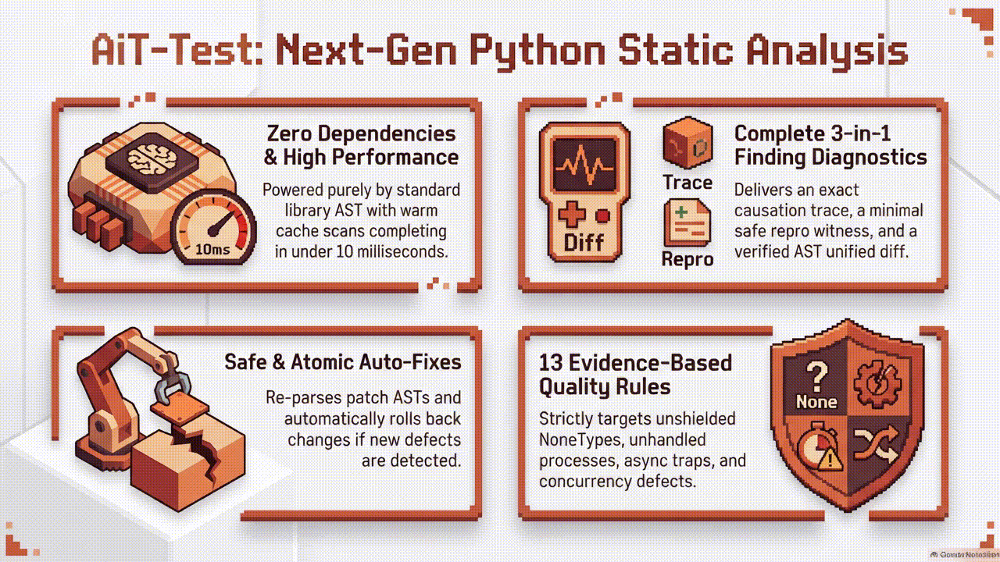
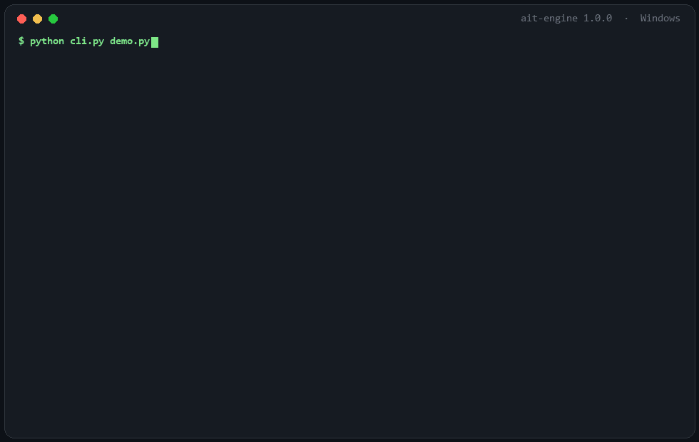

<h1 align="center">🛡️ AiT-test</h1>

<h3 align="center">Python static analysis that traces every finding back to its source</h3>

<p align="center"><b>Causation Trace · Repro Witness · Verified Patch · Zero Dependencies</b></p>



<p align="center"><i>Overview of the engine's four pillars · the numbers in the image come from the author's machine; reproducible figures are under <a href="#metrics">measured results</a></i></p>

---

<p align="center"><a href="#"></a> <a href="#"></a> <a href="#tests"></a> <a href="#ci"></a> <a href="#"></a> <a href="#rules"></a> <a href="#"></a> <a href="#credits"></a> <a href="LICENSE"></a></p>

<p align="center"><a href="docs/demo.txt">🎬 Real run</a> • <a href="#rules">🧭 13 rules</a> • <a href="#cli">🖥️ CLI</a> • <a href="#mcp">🤖 MCP</a> • <a href="#tests">🧪 Tests</a> • <a href="#ci">🔄 CI</a> • <a href="#credits">🏅 Credits</a></p>

<p align="center"><a href="README.md">English</a> · <a href="readme-th.md">ไทย</a></p>

> [!IMPORTANT]
> Runs on the standard library AST alone: **no runtime dependencies and no network access.**
> Witnesses are built as text and syntax-checked only; the code it flags is never executed.

---

## 🎯 The problem it solves

A regular linter points at a line but not at the path that made the value `None`.
You open the file, walk backwards to the origin, and guess whether your patch will break something else.

| ⚠️ The question left open | ⚡ What AiT-test answers in one result |
| :--- | :--- |
| Where did this `None` come from | **Causation trace**: every step carries `file:line:col` from the producer to the point of failure |
| How do I reproduce it | **Repro witness**: the smallest code that triggers the symptom, plus a `safe_to_execute` flag |
| Will the fix break something else | **Suggested fix**: a unified diff that passes `ast.parse` and is rescanned for new findings |
| Which file should I fix first | **A DEFECT needs evidence**: without concurrency or type evidence the finding drops to WARNING instead of guessing |

---

## ⚡ Getting started

Python 3.10 or newer. Nothing to install:

```bash
python cli.py src
```

Or install the `ait` / `ait-mcp` commands (still no dependencies):

```bash
pip install -e .
ait src
```

The distribution is named `ait-test` (`pip show ait-test`). The engine name reported by `--version` and by MCP `serverInfo` is `ait-engine 1.0.0`. Same project at two layers, not two packages.



<p align="center"><i>A real run on <code>demo.py</code>: N01 detected with a causation trace, witness and a diff that passed re-verification</i></p>

<details>
<summary><b>🎬 Click to expand: full output from the GIF above</b></summary>

The full transcript lives in [`docs/demo.txt`](docs/demo.txt), and the GIF above was recorded from the real run.

```text
$ python cli.py demo.py

================== [AIT-N01] Unshielded NoneType Dereference ===================
File: demo.py:10:10
Severity: DEFECT (Confidence: 0.90)
Function: render()
Symbol: value

  `value` can be None at this point but is dereferenced without a guard

--- Causation Trace ---
  Step 1 | demo.py:9:12
         | `lookup()` is declared to return `Optional[str]`, so the result can be None
  Step 2 | demo.py:9:4
         | `value` receives the return value of `lookup()`
  Step 3 | demo.py:10:10
         | `value` is dereferenced here without an `is None` guard

--- Suggested Fix ---
  --- a/demo.py
  +++ b/demo.py
  @@ -10,1 +10,3 @@
  +    if value is None:
  +        raise RuntimeError(f"value is unexpectedly None")
       print(value.upper())

========================= 1 failed, 0 passed in 2.59ms =========================
  DEFECT 1 · WARNING 0 · ADVICE 0
  exit code: 1
```

The code used for the demo:

```python
from typing import Optional


def lookup(key: str) -> Optional[str]:
    return None


def render() -> None:
    value = lookup("alpha")
    print(value.upper())
```

</details>

---

<a id="rules" name="rules"></a>
## 🧭 The 13 rules

<details>
<summary><b>📋 Click to expand: all 13 rules and the evidence each one requires</b></summary>

| ID | Level | What it catches | Evidence it requires |
|---|---|---|---|
| `AIT-Z01` | DEFECT | `Popen(..., stdout=PIPE)` followed by `wait()` without draining the pipe | a pipe exists and the child is waited on without a prior `communicate()`/`read()` |
| `AIT-Z02` | DEFECT | a child handle is dropped without `wait`/`poll`/returning ownership | the variable resolves to a process handle |
| `AIT-Z03` | WARNING | a process/thread spawned at module scope without `if __name__ == "__main__":` | the call really sits at module level |
| `AIT-R01` | DEFECT / WARNING | read-modify-write on shared state with no lock around it | concurrency evidence (spawn site, `async def`, or a lock in the class); otherwise not reported |
| `AIT-R02` | WARNING | a condition checked outside the lock and again inside it | a real lock region and the same condition |
| `AIT-A01` | DEFECT / WARNING | a blocking call inside `async def` | `time.sleep`/network/process = DEFECT, file I/O = WARNING; offloading through `to_thread`/executor is not reported |
| `AIT-A02` | WARNING | `create_task()` with nothing holding a reference | not stored in a variable, not awaited, no done callback |
| `AIT-A03` | DEFECT | a coroutine called without `await` | the callee resolves to a coroutine in the same file or to a known API |
| `AIT-M01` | DEFECT | mutating a caller's parameter in place (`append`, `pop`, `update`, ...) | the write targets the parameter name directly |
| `AIT-M02` | DEFECT | a mutable default argument (`[]`, `{}`, `set()`, ...) | a real mutable literal or constructor |
| `AIT-N01` | DEFECT | dereferencing a value that may be `None` without a guard | evidence the value is optional (annotation, `None` literal, a producer returning optional, `dict.get`) |
| `AIT-H01` | WARNING | a bare `except:` that swallows everything | `except: raise` (bare re-raise) is not reported because nothing is swallowed |
| `AIT-H02` | ADVICE | more than four levels of nested control flow | counts real control nodes only and never crosses a scope |

</details>

> [!NOTE]
> **Severity policy:** a DEFECT needs supporting evidence. When concurrency or type evidence is missing,
> the finding drops to WARNING instead of guessing, because one false finding is enough to make people stop reading the report.

---

<a id="cli" name="cli"></a>
## 🖥️ CLI

```text
python cli.py [target] [options]
```

| Flag | Effect |
|---|---|
| `-v, --verbose` | per-file detail |
| `-q, --quiet` | summary only |
| `-x, --exitfirst` | stop at the first file carrying a DEFECT |
| `--lf, --last-failed` | scan only the files that failed last run (needs the cache) |
| `--fix` | show a diff and ask one finding at a time (needs a TTY) |
| `--no-cache` | skip both cache reads and writes |
| `--maxfail N` | show at most N failure blocks |
| `--no-color` | disable ANSI (or set `NO_COLOR=1`) |
| `--version` | print the version |

**Exit code:** `0` clean · `1` DEFECT present · `2` interrupted · `3` parse or internal error · `4` usage error

> [!TIP]
> When `--lf` finds a cache it cannot open, no index, or no earlier run, it scans every file and says so on stderr.
> The alternative is analysing zero files and reporting "clean" without having read anything.

<details>
<summary><b>🔧 Click to expand: how <code>--fix</code> works (7 steps)</b></summary>

1. every patch is passed through `ast.parse` again before it is offered
2. findings are asked one at a time (`y` / `N` / `a` for all / `q` to quit)
3. before writing, the original is copied to `.ait_backup/<timestamp>-<pid>/`
4. the file is written to a temporary path and moved with `os.replace` (atomic), as bytes, so line endings are preserved
5. the file is written back with its original codec (`utf-8-sig` keeps the BOM, a BOM-less UTF-8 file stays BOM-less, `cp874` stays `cp874`)
   if a patch contains characters the original codec cannot encode, the write is refused rather than silently converting the file to UTF-8
6. that file is rescanned; any new finding triggers an immediate rollback
7. the whole target is rescanned at the end to confirm the final state; a Ctrl-C mid-way prints how many fixes were applied and where the backup lives

</details>

<details>
<summary><b>🔇 Click to expand: suppressing intended findings and <code>.aitignore</code></b></summary>

Inline directives work with or without the `AIT-` prefix (people tend to remember the rule number from the output):

```python
value.upper()  # ait: disable=AIT-N01
```

```python
except:  # ait: disable=H01
    pass
```

```python
except:  # ait: disable=ALL
    pass
```

A suppressed finding is not printed but is still counted in the summary line as `N suppressed`, so nothing disappears quietly.

Or put globs in `.aitignore` at the project root:

```text
legacy_*.py
build/
```

</details>

---

<a id="mcp" name="mcp"></a>
## 🤖 MCP

`mcp.py` speaks JSON-RPC 2.0 over stdio and works with any MCP client. stdout carries protocol frames only; logs go to stderr.

```json
{
  "mcpServers": {
    "ait": {
      "command": "python",
      "args": ["L:\\path\\to\\AiT-Test\\mcp.py"]
    }
  }
}
```

opencode (`opencode.jsonc`) uses `mcp.servers.<name>` with `command` as an array, not the `mcpServers` shape above:

```jsonc
{
  "mcp": {
    "servers": {
      "ait": {
        "type": "local",
        "command": ["python", "L:\\path\\to\\AiT-Test\\mcp.py"]
      }
    }
  }
}
```

`ait-mcp --help` and `ait-mcp --version` check the install without entering the serve loop.

| Tool | What it does |
|---|---|
| `ait_review` | scans a file or directory and returns findings with causation, witness and diff |
| `ait_slice_context` | returns source, variable table, calls and callers for one symbol (token-efficient) |
| `ait_verify_fix` | compares candidate code against the baseline: what is resolved and what is newly introduced |

<details>
<summary><b>📐 Click to expand: transport contract and the arguments each tool accepts</b></summary>

| Tool | Arguments |
|---|---|
| `ait_review` | `path` (required), `severity_min` = `ADVICE`/`WARNING`/`DEFECT`, `max_findings` = 1–500 (default 50), `exitfirst`, `use_cache` |
| `ait_slice_context` | `file_path`, `symbol_name` (required), `depth` = 0–3 (default 1) |
| `ait_verify_fix` | `file_path`, `candidate_code` (required) |

- `isError: false` when the tool ran successfully **even if it found a DEFECT**, because a finding is a usable result, not a tool failure
  (`isError: true` is reserved for the tool genuinely failing, for example a candidate that does not parse)
- an argument the schema does not declare, a wrong type, or an out-of-range value gets `-32602` instead of being ignored or silently clamped
- an unexpected exception (say `RecursionError`) is returned as `-32603` and the process keeps serving requests
- `shutdown` and `notifications/exit` stop the serve loop; `initialize` does not advertise a `logging` capability because none is used
- `structuredContent` holds the object once; `content[0].text` is a compact JSON mirror (no indentation) so the payload does not double in size

</details>

<details>
<summary><b>🧪 Click to expand: an <code>ait_verify_fix</code> call</b></summary>

```json
{"jsonrpc":"2.0","id":1,"method":"tools/call","params":{
  "name":"ait_verify_fix",
  "arguments":{
    "file_path":"demo.py",
    "candidate_code":"from typing import Optional\n\ndef lookup(k: str) -> Optional[str]:\n    return None\n\ndef render() -> None:\n    value = lookup('a')\n    if value is None:\n        return\n    print(value.upper())\n"
  }
}}
```

`ait_verify_fix` re-checks AST-level invariants; it is not a mathematical proof.
All it confirms is that the 13 rules find nothing in the new code, which does not mean the program is correct in every case.

</details>

---

## 📊 Capability and evidence

**0 runtime deps · offline · 13 rules · trace + witness on every finding · patches only where a deterministic fix exists (A01/A02/H02/M02/R01 have none) · digest-aware cache**

<details>
<summary><b>📋 Click to expand: nine dimensions and where the evidence lives</b></summary>

| Dimension | Status | Evidence in the project |
| :--- | :---: | :--- |
| Runtime dependencies | ✅ 0 | every import comes from the standard library; `python -S` still scans |
| Works offline | ✅ yes | no HTTP client, no telemetry |
| Causation trace | ✅ every finding | `causation[]` with `file:line:col` from producer to failure point |
| Repro witness | ✅ text + syntax check | never executed; deadlock/recursion demos carry `safe_to_execute: false` |
| Suggested patch | ✅ re-parsed and rescanned | a patch that introduces a new finding is rejected |
| Cache | ✅ sqlite3 WAL | key = path + size + mtime_ns + digest + ruleset bytecode + schema |
| Suppressed finding count | ✅ | the summary line reports `N suppressed` |
| Cross-file type knowledge | ⚠️ limited | annotations, literals and producers in the same file, plus hard-coded APIs |
| Proves the program correct | ❌ not the goal | 13 static rules, not formal verification |

</details>

---

<a id="metrics" name="metrics"></a>
## 📈 Measured on this machine

Measured on Windows 11 (AMD64) and WSL2 Ubuntu across three interpreters.

| Scenario | 3.12.10 (Windows) | 3.14.4 (WSL2 Ubuntu) | 3.15.0rc2 (Windows) |
|---|---|---|---|
| Scan `src/` (23 files, cold, `--no-cache`) | **642 ms** | **725 ms** | **510 ms** |
| Rescan (warm cache) | **12.3 ms** | **270 ms**\* | **9.9 ms** |
| Test suite (`unittest`, 268 tests) | **6.9 s OK** | **17.3 s OK** | **6.8 s OK** |
| DEFECT / WARNING / ADVICE on `src/` | 0 / 0 / 0 | 0 / 0 / 0 | 0 / 0 / 0 |

\* WSL reads the repo through `/mnt/l` (drvfs), which slows every sqlite round trip; the engine itself is not the slow part.

Engine size (`src/ait`, 23 files) **7,080 lines** · Runtime dependencies **0**

Numbers shift with the machine and file sizes; the cold/warm ratio says more than the absolute values.

---

## 🧠 How it works

<details>
<summary><b>🏗️ Click to expand: pipeline, cache, regression diff and witness</b></summary>

```text
discover ──► parse ──► scope tree ──► call graph ──► data flow
                 │                                        │
                 └────────────► 13 rules ◄────────────────┘
                                    │
                     findings ──────┼──────► causation trace
                                    │──────► repro witness
                                    └──────► suggested patch (re-parsed)
```

- **Cache** is sqlite3 (WAL), keyed on `path + size + mtime_ns + BLAKE2b digest + ruleset fingerprint + schema`.
  The digest is compared on lookup, so a rewrite that restores the same size and mtime (`git checkout`, `touch -r`, a restored backup)
  does not resurrect results for older content.
  The ruleset fingerprint hashes the bytecode of every rule, not just its name, so editing a detector invalidates old results.
  A corrupt DB file (bad magic header) is discarded and recreated once; if that fails too, the cache is switched off instead of crashing or looping.
- **Regression diff** compares finding counts per `(rule, symbol)`, not line numbers,
  so shifted lines do not produce phantom findings.
- **Witness** is generated as text and parsed for syntax only; nothing is executed
  (deadlock/recursion demos carry `safe_to_execute: false`).

</details>

---

## 🧱 Project structure

<details>
<summary><b>🗂️ Click to expand: the full file map</b></summary>

```text
AiT-Test/
├── cli.py                 # pytest-style entrypoint
├── mcp.py                 # JSON-RPC over stdio entrypoint
├── pyproject.toml         # packaging (license = MIT)
├── LICENSE                # MIT license text
├── .github/workflows/
│   └── ci.yml             # 4 jobs: test matrix (12) + package + lint + security
├── .github/dependabot.yml # SHA-pinned actions, updated weekly
├── src/ait/
│   ├── engine.py          # discover / scan / compare_findings / verify_fix
│   ├── models.py          # Diagnostic, Patch, Witness, ScanResult
│   ├── context.py         # guard detection, suppression, patch builders
│   ├── cache.py           # sqlite3 cache + corruption recovery
│   ├── reporter.py        # terminal renderer
│   ├── slicer.py          # ait_slice_context
│   ├── flow/              # scope tree, call graph, data flow, witness
│   └── rules/             # 13 rules
├── tests/                 # unittest + fixtures
└── docs/                  # demo.gif, demo.txt, assets/
```

| Layer | File | Responsibility |
| :--- | :--- | :--- |
| Frontend | `cli.py` | flag parsing, rendering, the `--fix` session, exit codes |
| Frontend | `mcp.py` | JSON-RPC framing, tool schema and validation, stdio loop |
| Core | `engine.py` | discover → parse → analyze → cache → aggregate |
| Core | `context.py` | guard/dominance lookup, suppression, evidence and patch builders |
| Flow | `flow/scope_tree.py` | symbol table, lexical scopes, binding resolution |
| Flow | `flow/call_graph.py` | call sites, lock regions, spawn sites |
| Flow | `flow/data_flow.py` | backward tracing of optional/`None` sources |
| Flow | `flow/witness.py` | minimal repro text and syntax validation |
| Rules | `rules/*.py` | 13 detectors (Z/R/A/M/N/H) |
| Infra | `cache.py` | sqlite3 WAL, digest and ruleset keyed, prune, `--lf` index |
| Infra | `models.py` | immutable Diagnostic/Patch/Witness, exit codes, SCHEMA_VERSION |
| CI | `.github/workflows/ci.yml` | test matrix, self-scan, stdlib-only run, integration tests |
| CI | `tests/test_cli_integration.py` | drives the real `cli.py` / `mcp.py` through subprocess and asserts exit codes and JSON |

</details>

---

<a id="tests" name="tests"></a>
## 🧪 Tests

No pytest required:

```bash
python -m unittest discover -s tests -v
```

The fixtures come in pairs: `bad_*.py` (must be caught) and `clean_*.py` (must stay silent).
The suite also asserts that the engine imports nothing outside the standard library (`python -S` still runs it).

```text
Ran 268 tests in ~7s
OK
```

<details>
<summary><b>🖥️ Click to expand: results on 8 interpreters and the environment table</b></summary>

Confirmed on 8 interpreters (7 on Windows 11, 1 on WSL2 Ubuntu): every one returns 268 tests OK, a clean `src/`, and exit 0.

| Interpreter | Source |
|---|---|
| CPython 3.10.21 | uv-managed (Windows 11) |
| CPython 3.11.16 | uv-managed (Windows 11) |
| CPython 3.12.10 | Windows 11 (system) |
| CPython 3.12.14 | `L:\.Python312` |
| CPython 3.13.15 | `L:\.Python313` |
| CPython 3.14.7 | `L:\.Python314` |
| CPython 3.15.0rc2 | `L:\.Python315` |
| CPython 3.14.4 | WSL2 Ubuntu |

```text
3.10.21  → Ran 268 tests in 7.152s OK
3.11.16  → Ran 268 tests in 6.990s OK
3.12.10  → Ran 268 tests in 6.928s OK
3.12.14  → Ran 268 tests in 6.698s OK
3.13.15  → Ran 268 tests in 6.724s OK
3.14.4 (WSL2 Ubuntu) → Ran 268 tests in 17.332s OK
3.14.7   → Ran 268 tests in 7.319s OK
3.15.0rc2 → Ran 268 tests in 6.769s OK
```

All 8 scan the 23 files under `src/` without a finding and exit 0.
`tests/fixtures` exits 1 as it should (DEFECT 11 · WARNING 4 · ADVICE 1).

On 3.15 the suite also passes with `-W error::DeprecationWarning` for all 268 tests,
which means the engine does not touch APIs scheduled for removal, and `python -S` (no site) scans normally.

</details>

---

<a id="ci" name="ci"></a>
## 🔄 CI (GitHub Actions)

CI runs on GitHub Actions with every action pinned to a **commit SHA** (not a floating tag), and Dependabot updates them weekly.

<details>
<summary><b>🧪 Click to expand: the <code>test</code> job across 12 environments</b></summary>

| Step / test | What it checks | Pass condition |
|---|---|---|
| `python -m unittest discover -s tests` | 268 tests on that interpreter | must be `OK` |
| `-W error::DeprecationWarning` (3.15 only) | whether it uses APIs scheduled for removal | must be `OK` |
| `python cli.py src --no-cache` | the engine scanning itself | exit 0 · DEFECT/WARNING/ADVICE = 0 |
| `python -S cli.py src --no-cache` | no site-packages at all | exit 0, so nothing third-party is required |
| `tests/test_cli_integration.py` (scans `tests/fixtures` through `cli.py`) | a corpus that is meant to fail | exit **1** and a `DEFECT` in the output |
| `tests/test_mcp_protocol.py` (`mcp.py` over stdio) | real JSON-RPC (`initialize` → `tools/call` → `shutdown`) | `isError:false` · 0 findings · `shutdown` answered |

`tests/test_cli_integration.py` and `tests/test_mcp_protocol.py` call `cli.py` / `mcp.py` through `subprocess` the way a user would, instead of importing internal functions.
That catches regressions at the entrypoint level: a wrong exit code, logs leaking into stdout, a broken protocol frame.

</details>

<details>
<summary><b>📦 Click to expand: the <code>package</code> / <code>lint</code> / <code>security</code> jobs</b></summary>

| Job | Tool | What it checks | Pass condition |
|---|---|---|---|
| `package` | `pip wheel` + a clean venv | builds the wheel, installs it with `--no-index --no-deps`, runs `ait --version`, `ait sample.py` and `ait-mcp` outside the source tree | exit 0 for every command |
| `package` | `importlib.metadata` | metadata must have no `Requires-Dist` and all 5 modules must import | `requires == None` |
| `lint` | **Ruff 0.17.2** | `E4/E7/E9/F` (undefined names, unused imports, syntax) | 0 findings |
| `lint` | **Bandit 1.9.4** | medium and above in `src`, `cli.py`, `mcp.py` | 0 findings |
| `lint` | `compileall` | every module compiles | exit 0 |
| `lint` | **actionlint 2.2.0** | workflow syntax and expressions | exit 0 |
| `security` | **OSV-Scanner 2.7.0** | the dependency surface against the OSV database | `No issues found` |
| `security` | shell guard | any `requirements*.txt` / `uv.lock` / `poetry.lock` must stop the run for a real scan | no lockfile found |

Ruff found something the engine itself cannot: `F821 Undefined name 'List'` in `rules/registry.py`,
hidden under `from __future__ import annotations` so it never failed at runtime, but ready to break the moment anyone calls `get_type_hints`. Fixed.

Bandit reports two `B101 assert` sites (`cache.py`, `cli.py`) at **low severity**.
Both asserts are internal invariants after type narrowing, so the threshold is `-ll` (medium and above) and the low findings stay by design.

</details>

<details>
<summary><b>🔐 Click to expand: why CodeQL / dependency-review are not enabled</b></summary>

Both require **GitHub Advanced Security** when the repo is private (CodeQL uses code scanning, dependency-review uses the dependency graph API).

If the repo is public and you want them, add a separate `.github/workflows/codeql.yml`:

```yaml
name: CodeQL
on:
  push:
    branches: [main]
  schedule:
    - cron: "0 3 * * 1"
permissions:
  contents: read
  security-events: write
jobs:
  analyze:
    runs-on: ubuntu-latest
    steps:
      - uses: actions/checkout@3d3c42e5aac5ba805825da76410c181273ba90b1 # v7.0.1
      - uses: github/codeql-action/init@793b778da9c9275a0f276522b27cb5fc14bba279 # v4
        with:
          languages: python
          queries: security-and-quality
      - uses: github/codeql-action/analyze@793b778da9c9275a0f276522b27cb5fc14bba279 # v4
```

</details>

---

## ⚠️ Limits

> [!WARNING]
> Read this before relying on it. The tool answers a narrow set of questions well, and does not replace a type checker, a test suite or code review.

- It is **static analysis**: it never runs the code, so it cannot know real runtime values.
- There is no full type inference, so it knows annotations, literals, producers in the same file, and hard-coded APIs.
- Cross-module: an optional value that comes from a file outside the scan is invisible.
- `AIT-R01` reports only when concurrency evidence exists; a project that spawns threads through an unusual abstraction may slip past.
- A witness is "an example that triggers the symptom", not a test case ready for CI.
- A patch is a syntactic suggestion and may not match your architecture (whether to `raise` or `return` depends on context).

If false positives worry you more than false negatives, start with `--maxfail 5` and go one at a time.

---

<a id="credits" name="credits"></a>
## 🏅 Credits and titles

<p align="center"><b>xTanTHaix</b><br><i>Project Architect · Maintainer · Copyright holder of AiT-test</i></p>

<details>
<summary><b>🎖️ Click to expand: titles tied to actual work in this project</b></summary>

| Title | Basis |
| :--- | :--- |
| 🏛️ Architect of the 13 Rules | designed the 13-rule set (Z/R/A/M/N/H) and the "a DEFECT needs evidence or it drops to WARNING" policy |
| 🧪 Eight-Interpreter Verifier | confirmed 268 tests on CPython 3.10 → 3.15 across Windows 11 and WSL2 Ubuntu |
| 🛡️ Zero-Dependency Keeper | 23 engine files, 7,080 lines, no runtime dependency and fully offline |
| 🤖 MCP Toolsmith | JSON-RPC 2.0 contract for three tools with validation, `structuredContent` and a lifecycle that really closes |
| 🔁 CI Gatekeeper | 4 jobs / 15 runs: test matrix on 12 environments + package + lint (ruff, bandit, actionlint) + OSV |

</details>

---

<p align="center"><a href="https://ko-fi.com/xtanthaix"></a></p>

<p align="center"><i>Written and maintained by <a href="https://ko-fi.com/xtanthaix">xTanTHaix</a> · if AiT-test saved you time, you can buy the developer a coffee at <a href="https://ko-fi.com/xtanthaix">ko-fi.com/xtanthaix</a> ☕</i></p>

---

## 📜 License

MIT. The license expression is declared in `pyproject.toml` (`license = "MIT"`), and the full text is in [`LICENSE`](LICENSE).

---

<p align="center"><i>Static invariants, causation traces and verified patches, with zero runtime dependencies.</i></p>
